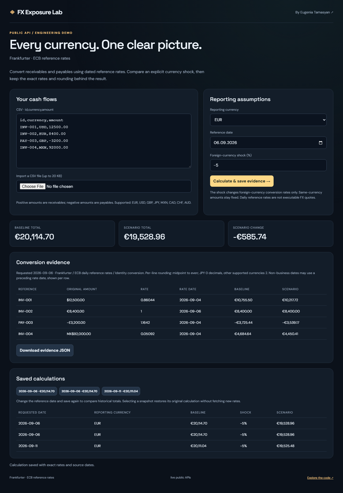
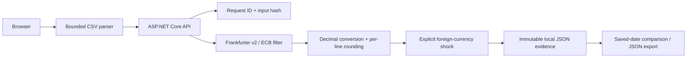

# FX Exposure Lab

[](https://github.com/itinessity/fx-exposure-lab/actions/workflows/ci.yml)


A reproducible multi-currency cash-flow calculator. Import balances, apply dated ECB reference rates, compare an explicit shock and export the calculation evidence.

**[Eugenia Tamasyan](https://itinessity.com)** · Senior .NET Backend Engineer · FinTech & Distributed Systems



## What you can try

- CSV import with quoted fields, unique row IDs, signed decimal amounts and a 100-row bound.
- Eight currencies: EUR, USD, GBP, JPY, MXN, CAD, CHF and AUD.
- Frankfurter v2 queries explicitly filtered to ECB rates, with actual source dates shown per line.
- Up to seven days of lookback for missing/non-business dates; missing rates are errors, never invented prices.
- Decimal calculations, per-line midpoint-to-even rounding and totals calculated from the rounded lines.
- User-defined foreign-currency shocks from −50% to +50%; identity conversions remain unchanged.
- Persistent immutable snapshots, request-ID idempotency and historical comparison through saved calculations.

## Run locally

Requires the **.NET 10 SDK**. No provider account or API key is needed. Internet access is required for live data.

```bash
dotnet run --project src/App.csproj -c Release
```

Open **http://127.0.0.1:8080**. The application binds to loopback by default. To run several demos simultaneously, set a different `ASPNETCORE_URLS` per process. Each repository is independent.

Or use Docker:

```bash
docker compose up --build
```

The container also exposes only local port 8080 through Compose. It runs as the .NET image's non-root `app` user. Stop it with `docker compose down`; the named data volume persists.

Saved JSON lives under `DATA_DIR` (default `.data` relative to the process working directory). Writes use a temporary file and atomic rename in a single process. The store caps records at 200 and lists the 30 most recent in the UI. Export and remove old local records when capacity is reached. Do not share this directory between multiple application processes.

## Walkthrough

1. Keep the example cash flows or import a UTF-8 CSV with header `id,currency,amount`.
2. Choose a reporting currency, reference date and optional shock. Positive amounts are receivables, negative amounts are payables.
3. Calculate and save. Inspect each conversion rate and its actual date, then download the evidence.
4. Change the reference date and save again to compare historical totals in the saved-calculations table.
5. Select an older snapshot to restore its original result without contacting the rate provider.

## Architecture



The backend uses ASP.NET Core minimal APIs and built-in .NET libraries. The browser uses plain JavaScript and CSS; Node.js is needed only for browser tests. Provider/domain logic is separated from the HTTP endpoints in `src/`. The common infrastructure is intentionally small enough to inspect.

## API

| Endpoint | Behavior |
|---|---|
| `POST /api/calculate` | `{ "csv": "id,currency,amount\na,USD,120", "reportingCurrency": "EUR", "date": "2026-09-01", "shockPercent": -5, "requestId": "unique-client-id" }` |
| `GET /api/snapshots` | Up to 30 recent calculation IDs |
| `GET /api/snapshots/{id}` | Original rates, line amounts, totals and provenance |
| `GET /api/health` | Process status and an explicit live/fixture mode label |

The API accepts JSON request bodies and returns structured errors. Bodies are limited to 64 KB. Browser writes with a foreign Origin are rejected. The health endpoint reports process availability, not guaranteed provider availability.

## Verify

```bash
dotnet build src/App.csproj -c Release
dotnet run --project tests/Tests.csproj -c Release
python tests/integration.py
npm ci
npx playwright install chromium
npm run test:browser
```

Quoted CSV and escaped quotes, duplicate IDs, currency/date/amount limits, midpoint rounding, mixed-currency totals, identity conversions, shock bounds, idempotency conflicts and exact stored-evidence retrieval. Browser tests cover calculation and historical snapshot selection.

The C# checks are dependency-free executable assertions. HTTP tests launch an isolated process with a temporary data directory. Playwright covers the primary user flow and mobile overflow. CI runs all three layers on Ubuntu, builds a Release publish output and uses deterministic fixtures, so it does not depend on public-provider uptime.

Fixtures require **both** `ASPNETCORE_ENVIRONMENT=Testing` and `TestFixtures=true`. The UI labels fixture mode. Real-provider outages are never replaced by fixture data. Local live-provider and visual smoke checks are documented in [verification notes](docs/VERIFICATION.md).

## Boundaries and trade-offs

These are daily reference rates, not executable intraday FX prices. A date before today's ECB publication can use the preceding available rate; the actual `rateDate` is always visible. Same-currency conversion uses a rate of one and needs no external request.

Amounts allow at most four decimal places and an absolute value of one billion. Reporting rounds each line to two decimal places, except JPY (zero); midpoint ties round to even. The scenario multiplies each foreign-currency rate by `1 + shockPercent / 100`; it is a user assumption, not a forecast. Opposing payables and receivables may offset in the net total.

Idempotency is scoped to a local persisted request ID and exact input hash. Reusing the ID with changed input returns 409. The UI generates a new ID when inputs change. Semantically identical CSV files with different formatting are distinct inputs. Saved evidence is reproducible after provider changes; it is not digitally signed. Historical comparison is through independently saved dates, not a continuous backtest chart.

This demo has no tenant isolation: do not use real confidential invoices on a shared instance. Exports are JSON, avoiding spreadsheet formula execution from imported row labels.

This is a runnable local reference implementation, not a publicly hosted production service. Before deploying it for shared use, address the controls listed in [SECURITY.md](SECURITY.md). Original code is MIT-licensed; external data and vendored assets retain their own terms.

## Data sources

- [Frankfurter documentation and API](https://frankfurter.dev/)
- [Frankfurter open-source implementation](https://github.com/lineofflight/frankfurter)
- [ECB reference-rate information](https://www.ecb.europa.eu/stats/policy_and_exchange_rates/euro_reference_exchange_rates/html/index.en.html)

## About the author

I build .NET backends, trading integrations and reliable data workflows. See [itinessity.com](https://itinessity.com) for commercial experience and ways to work together.
